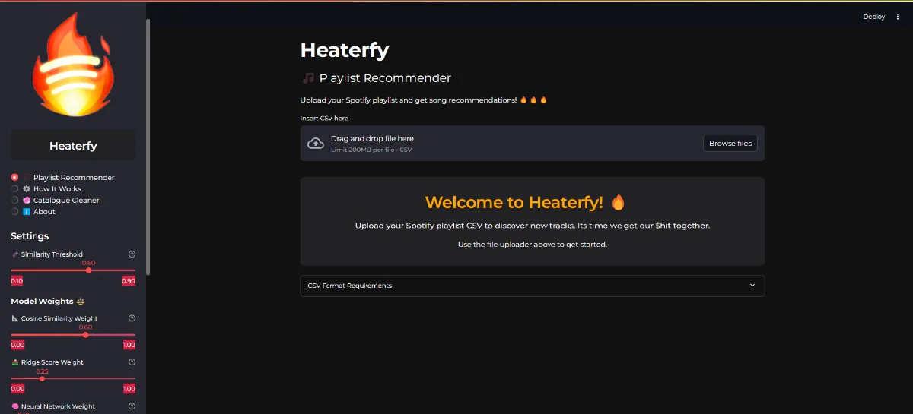
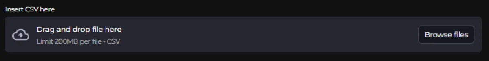
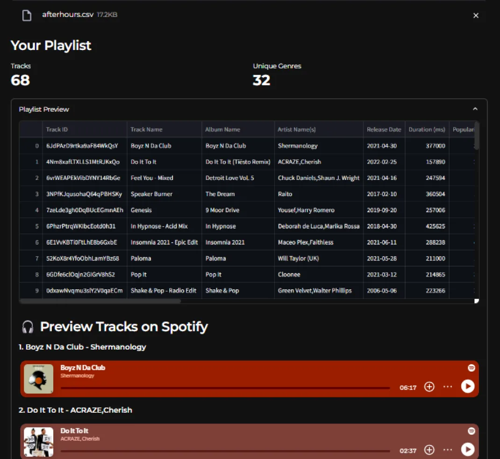
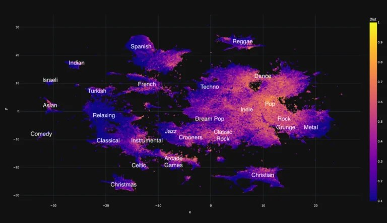
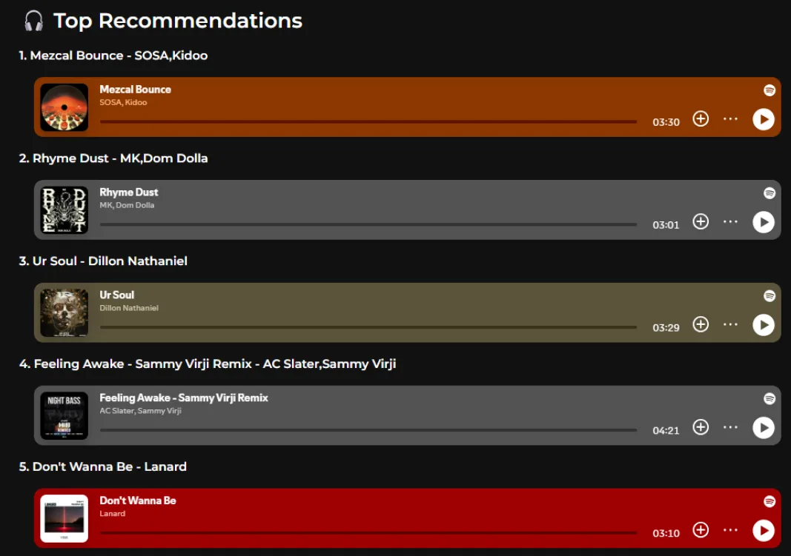
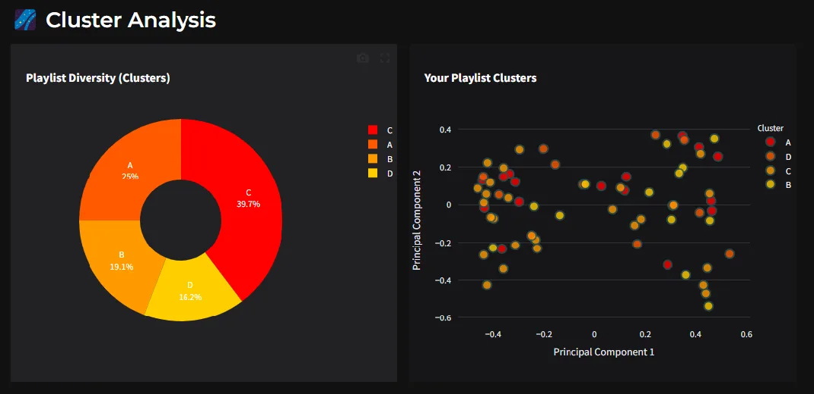
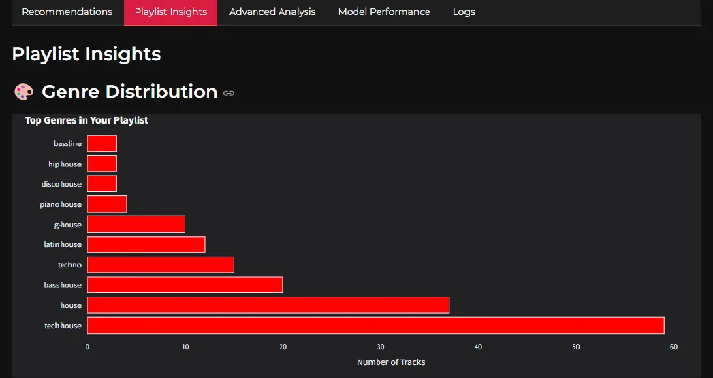

# Heaterfy

Heaterfy is a playlist recommendation engine built around a simple idea: recommending songs is not just about matching genre labels or throwing a neural network at audio features. It is about preserving the *feel* of a playlist. The system takes a Spotify playlist as input, analyzes its audio profile, genre structure, release-year distribution, and internal variation, then returns recommendations that sound like they belong there.

### Overview

The project is built as a full user-facing application rather than a backend script. Users upload a playlist CSV exported from Spotify through Exportify, preview the tracks inside the app, generate recommendations, and inspect the analysis behind the results. The Streamlit interface includes:
- playlist preview
- top recommendations with Spotify embeds
- genre and audio-feature analysis
- release-year distribution
- clustering visualizations
- model-by-model output comparisons
- full process logs

That interface is a major part of the project. The system does not just output a ranked list; it exposes how the playlist is being interpreted and how each model contributes to the final result.

### Input and preprocessing

The pipeline begins by ingesting a playlist CSV and matching it against a larger music catalogue. Before any recommendation model runs, the data is cleaned and normalized so that the feature space is usable.

That preprocessing includes:
- filling missing genre metadata
- standardizing and normalizing the playlist and catalogue data
- extracting release years from release dates
- removing low-value columns
- dropping duplicate or unhelpful rows
- removing tracks that already exist in the input playlist

One of the practical problems in the source data was that many tracks were missing genre tags entirely. To address that, the project includes a genre-filling step using external metadata so that tracks are not discarded or underrepresented just because Spotify’s metadata is incomplete.

### Genre embeddings

The most important part of Heaterfy is the genre embedding system.

A flat genre label like “house,” “rock,” or “metal” is too crude for recommendation. It ignores how closely related genres actually are, and it collapses a lot of useful information in the process. Heaterfy handles this by representing genres in a continuous space instead of a simple categorical bucket.

The system scrapes the **EveryNoise** genre map, which places thousands of genres according to musical similarity, then builds a graph from that structure and trains a **Node2Vec** model on it. Each genre is embedded into a **16-dimensional vector**, and each track gets a genre representation by averaging the embeddings of its tags.

This lets the system reason about genre similarity the way embedding models reason about similarity in language: tracks with different text labels can still be close if they sit in the same region of musical space. That is especially important for subgenre-heavy playlists, where reducing everything to one broad category destroys the actual vibe.

### Recommendation pipeline

Heaterfy is not one model. It is a staged recommendation pipeline where each layer handles a different part of the problem.

The full flow looks like this:

1. **Fill missing genres**  
   Missing genre values are recovered from the catalogue or external metadata where possible.

2. **Compute genre embeddings**  
   Genre tags are converted into 16-dimensional vectors for similarity-aware comparisons.

3. **Clean and normalize the data**  
   Both the input playlist and the main catalogue are standardized into the feature space expected by the models.

4. **Initial filtering with XGBoost**  
   A boosted tree classifier removes tracks that clearly do not fit the playlist, shrinking the search space before more detailed scoring begins.

5. **Release-year adjustment**  
   The system detects whether the playlist is modern, decade-specific, or mixed-era, then applies bonuses or penalties to candidates based on how far their release years deviate from the playlist profile.

6. **Ridge regression scoring**  
   A regression model scores tracks based on their audio similarity to the playlist.

7. **Cosine similarity scoring**  
   The system compares candidate tracks against the playlist’s average audio profile using features such as danceability, energy, tempo, valence, loudness, instrumentalness, and speechiness.

8. **GLM metadata scoring**  
   A generalized linear model adds softer signals using metadata such as artist, album, label, popularity, and release date.

9. **K-means clustering**  
   The playlist is clustered so the final recommendations preserve its internal diversity instead of collapsing toward one average sound.

10. **Neural network layer**  
    A neural model combines multiple scores and feature groups as an experimental layer.

11. **Final weighted selection**  
    The strongest scorers are combined into a final weighted ranking, then cluster-based diversity selection is applied to produce the recommendation set.

That architecture is what gives Heaterfy its character. It behaves more like a curation engine than a single-model recommender.

### Audio scoring

The two strongest models in practice were the **cosine similarity** scorer and the **ridge regression** scorer.

Cosine similarity measures how closely a track matches the playlist’s average audio feature profile. Ridge regression does something similar through a learned scoring function, and the two frequently produced similar high-quality results. In the final weighting, cosine received the strongest emphasis, with ridge acting as the second major signal.

This turned out to be one of the useful conclusions of the project: simpler models with strong feature design were more reliable than the more experimental neural network layer. That is a better engineering result than pretending the most complex model automatically won.

### Temporal logic

One of the most effective parts of the system is not machine learning at all.

Heaterfy includes a release-year adjustment stage that detects whether the playlist is:
- modern / recent
- concentrated in a specific decade
- mixed across eras

It then boosts or penalizes candidates accordingly. This was added because purely audio-based models would sometimes surface older songs that technically matched the sonic profile but did not actually fit the playlist’s temporal context. For a recent after-hours house playlist, that meant random old outliers appearing in results. For an older funk playlist, it could mean over-recommending newer tracks with similar production traits but the wrong cultural and temporal feel.

The year adjustment fixes that in a direct, controllable way.

### Diversity and clustering

A playlist is usually not one thing.

Even when the overall mood is coherent, most strong playlists contain multiple sub-vibes. Heaterfy models that variation using **K-means clustering** and then preserves that cluster distribution in the final recommendation set.

That means the system does not just recommend songs close to the average track. It tries to keep the same internal balance the playlist already has. For example, if the source playlist has a mix of heavier tracks, groovier tracks, and more stripped-down tracks, the recommendation list will reflect that ratio instead of flattening everything into one mode.

A PCA projection is also used in the interface to visualize the cluster structure and make the playlist’s internal shape easier to inspect.

### Results

The system performed well across very different genres and playlist types.

The report includes examples across:
- funk / disco / soul playlists
- late-night house and after-hours club playlists
- metal playlists
- niche genre-heavy playlists

That breadth matters because it shows the system is not tied to one narrow musical niche. The after-hours playlist example is a good illustration of what Heaterfy is trying to preserve: not just “house music,” but a specific subset of house tracks that fit a sweaty 3AM-to-10AM club set rather than generic mainstage material. The same principle holds for funk crates and metal playlists. The recommendations are not just close on paper; they are tracks the curators actually felt belonged in the playlist.

The report also documents that the system produced usable recommendations across genres like rock, country, rap, R&B, K-pop, vaporwave, phonk, Ukrainian rap, and castlecore. That is a strong sign that the pipeline generalizes because it is modelling playlist structure rather than memorizing one genre family.

### Stats

The app exposes full process logs showing:
- catalogue size
- playlist size
- detected top genres
- genre embedding status
- classification filtering results
- release-year adjustment statistics
- top results per model
- cluster distribution before and after final selection
- final score distributions

That is useful both for debugging and for trust. The system does not behave like a black box. You can see what happened at each stage and why the final recommendation list looks the way it does.

### Outcome

Heaterfy ended up being much more than a basic playlist recommender. It became a full recommendation and analysis system that combines:
- embedding-based genre reasoning
- audio-feature similarity
- metadata scoring
- release-year logic
- diversity preservation
- a user-facing interface for exploration and playback

