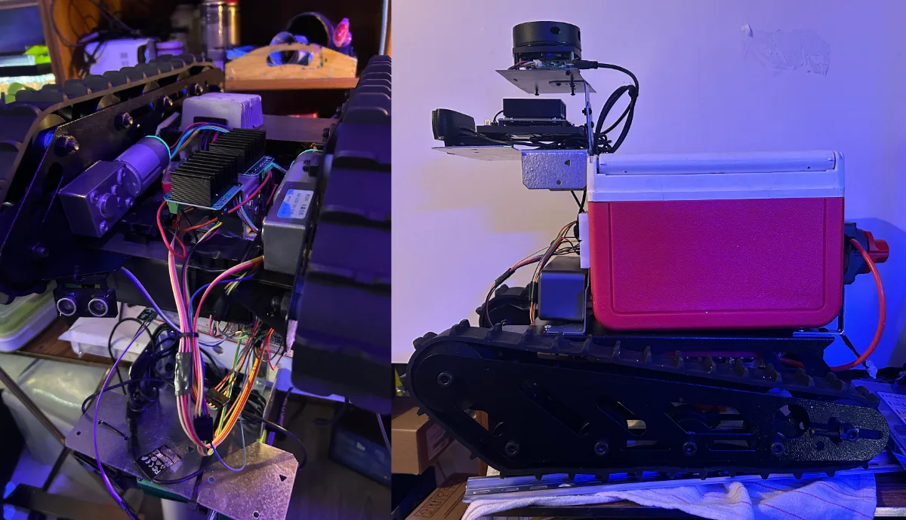
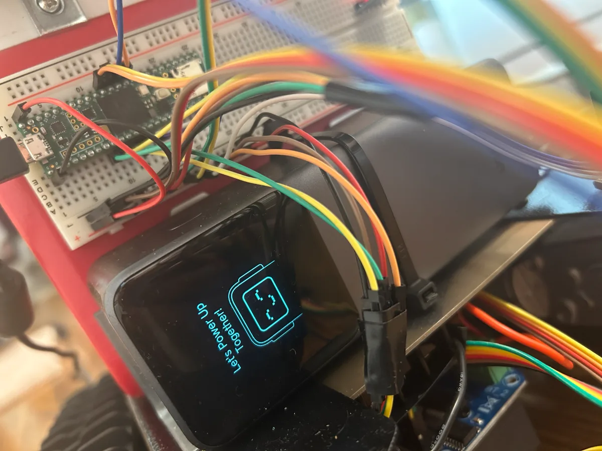
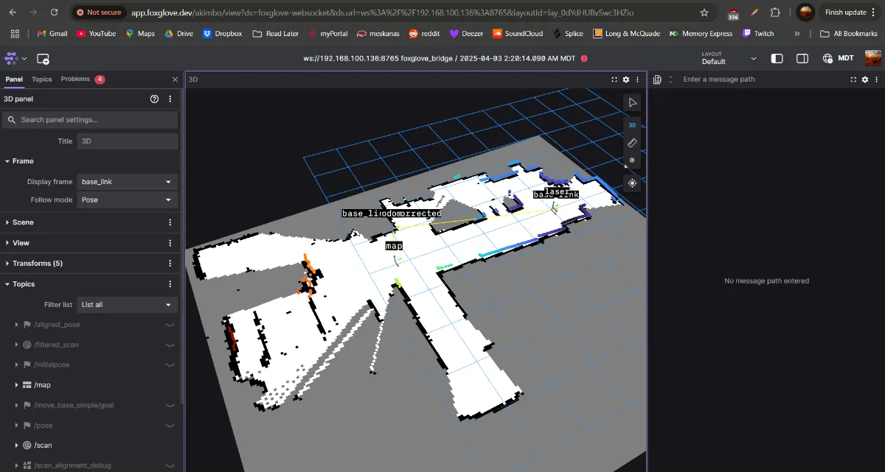

## SLAM Delivery Robot

This is a **SLAM bot** built for indoor campus delivery.  
SLAM  (**simultaneous localization and mapping**) bots build a map of an unknown environment while estimating its own position inside that map. In this case, the target environment was MacEwan University. The system was developed to move through indoor hallways, generate a usable map, localize within that map, and execute navigation goals between real locations on campus.

### Overview

The robot is built on a tracked mobile base with a cargo compartment, onboard compute, and a 360° LiDAR mounted high enough to scan the environment without self-occlusion. The original goal was indoor delivery-style navigation using LiDAR-based mapping and obstacle avoidance. Development continued beyond the original report, and the final system was able to produce a full map of MacEwan’s second floor, covering the connected buildings on that level.

### Architecture

The platform is split between two control layers.

A **Jetson Orin Nano** runs the high-level stack in **ROS2 Humble**. This side handles LiDAR processing, mapping, localization, navigation, and perception. It also runs the ROS nodes that connect the sensors, publish robot state, and coordinate movement.

A **Teensy 4.1** handles the low-level side. Custom C++ firmware on the microcontroller receives velocity commands over serial, converts them into differential motor outputs, reads wheel encoders, computes odometry, and enforces safety behavior in real time. This split keeps the fast control loop on the microcontroller while leaving the Jetson free to run the more expensive robotics workloads.

### Hardware and sensing

The drivetrain uses dual **24V worm gear DC motors** driven through **BTS7960 H-bridge modules**. The robot runs on a tracked chassis, which gives it good traction and payload support, but also introduces rotational slip that has to be accounted for in the control and localization pipeline.

The sensing stack includes:
- **RPLiDAR A1M8** for 2D 360° scan data
- **wheel encoders** for odometry
- **HC-SR04 ultrasonic sensing** for close-range fail-safe stopping
- **IMU** for additional motion data
- **USB camera** for computer-vision-based obstacle and person awareness

The Jetson and sensors are powered separately from the drivetrain so motor load does not interfere with compute stability.

### Software stack

The ROS2 stack is launched from a navigation entry point that brings up the core robot nodes in order.

A custom **Teensy bridge node** connects the microcontroller to ROS over serial. It publishes odometry and distance data, subscribes to `/cmd_vel`, and forwards motion commands to the firmware. A separate movement controller handles higher-level motion requests and command timing.

For mapping, the robot uses **SLAM Toolbox** in asynchronous mode. LiDAR scans are provided through the `sllidar_ros2` driver, and static transforms connect the laser frame to `base_link` so scans can be placed correctly in the robot frame. The resulting occupancy grid is visualized live in **Foxglove**, which was also used for debugging transforms, odometry, and map quality during testing.

The navigation layer was later extended with **Nav2** for autonomous goal execution. Once a map exists, the robot can localize within it, plan a path to a target, and follow that path through the building.

### Motion control and safety

The firmware on the Teensy is structured around serial communication, motion control, encoder handling, and robot state management.

Incoming `CMD_VEL` commands are parsed and translated into track speeds. A proportional control layer and a PID-based balancing routine are used to reduce drift and keep straight-line movement stable. Encoder deltas are converted into odometry and sent back to the Jetson so the higher-level stack can localize and plan.

Safety logic runs continuously at the firmware level. If the ultrasonic sensor detects an obstacle inside the configured threshold, the robot stops immediately. Recovery timing is enforced before motion resumes. A watchdog also stops the robot if commands stop arriving, and manual STOP commands can override movement at any time. Gradual deceleration is used instead of hard cuts to reduce jerk and prevent unnecessary slippage.

### What it does in practice

In operation, the robot performs the same sequence as a real indoor autonomous delivery platform:

1. Start the ROS2 stack and bring up the control, sensing, and SLAM nodes  
2. Ingest live LiDAR and odometry data  
3. Build or load a map of the indoor environment  
4. Localize the robot within that map  
5. Accept navigation goals through Nav2  
6. Plan and execute paths through hallways and shared spaces  
7. Stop or re-route when obstacles are detected

