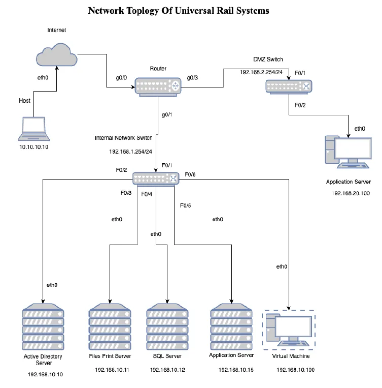
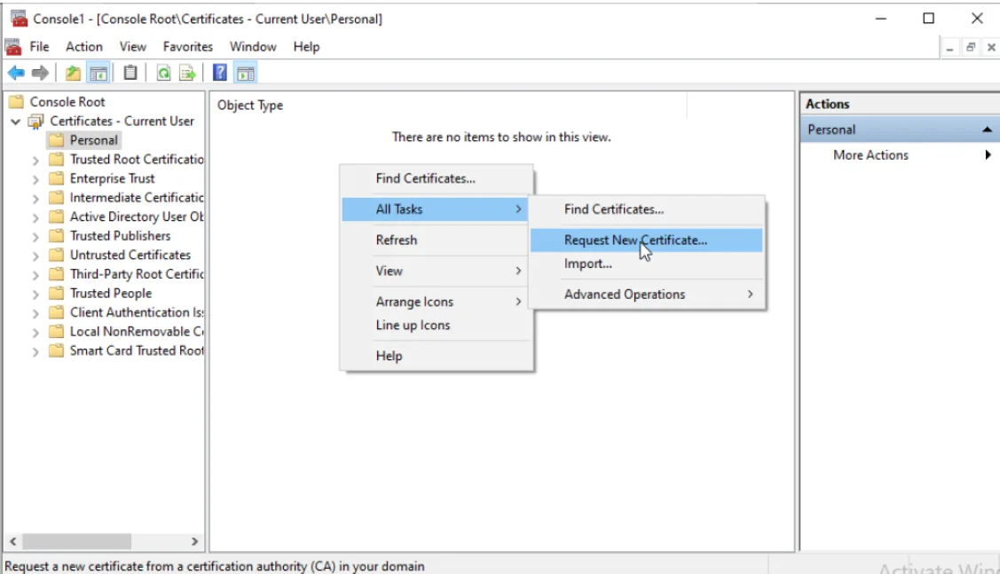

## Zero Trust Security Audit

This project is a Zero Trust redesign and proof-of-concept for Universal Rail Systems. The focus was internal east-west traffic: the communication that happens between servers, user devices, and internal services after someone is already inside the network. In a traditional flat network, that traffic is often trusted by default. The goal here was to replace that assumption with explicit authentication, segmentation, and encryption between systems that should communicate and systems that should not.

### Overview

The starting point was a typical perimeter-heavy design. Core services such as Active Directory, SQL, file sharing, printing, and internal applications were able to communicate broadly on the same network, with limited isolation between roles. That works operationally, but once one machine is compromised, lateral movement becomes much easier.

The Zero Trust design changes that model. Instead of trusting traffic because it originated on the internal network, access is granted only when identity, device trust, and connection policy all line up. In practical terms, that meant:
- certificate-based authentication between systems
- strict service-to-service access rules
- segmentation between internal resources and the DMZ
- least-privilege access for users, machines, and service accounts
- encrypted internal traffic rather than relying on “inside the network” as a security boundary

### Virtualized proof-of-concept environment

To test the design, the network was recreated as a proof-of-concept in a virtualized environment.

The deployment used **Proxmox VE** to host the server fleet and **VyOS** as the router between network segments. The environment included:
- an **Active Directory / Certificate Authority** server
- a **File / Print Server**
- a **SQL Server**
- an **Application Server**
- a **DMZ application server**
- a **client / remote desktop machine** for access testing

The topology separates internal services from public-facing infrastructure using distinct subnets and a DMZ. That layout makes the trust boundaries explicit and gives the router and host firewalls meaningful enforcement points rather than leaving everything in one unrestricted broadcast domain.

### Identity as the control plane

The core of the design is **Active Directory** and **certificate-based trust**.

A Windows Server 2022 instance was configured as the domain controller for urs.local and also deployed as an **Enterprise Root CA** using **Active Directory Certificate Services**. Certificate templates were created for both client and server authentication, and certificates were distributed to domain-joined systems through Group Policy auto-enrollment.

This is what makes the Zero Trust model practical. Once machines and services have verifiable identities, internal access decisions can be based on certificates and policy rather than IP reachability alone. A device without a valid certificate is not just “unrecognized”; it becomes unable to participate in trusted service communication.

### Mutual TLS between internal services

The main technical control used throughout the design is **mutual TLS**.

Normal TLS proves the identity of the server to the client and encrypts the connection. **mTLS** extends that by requiring the client to present a valid certificate as well. That means both sides authenticate each other during the handshake before any useful communication happens.

In this project, mTLS was used to secure east-west traffic between internal components. That changes the trust model significantly. Internal traffic is no longer allowed because it came from the right subnet; it is allowed because the device, user, and service can all prove who they are.

### Application server

The application tier was configured behind **IIS** using a reverse proxy model.

IIS was set up to:
- terminate HTTPS
- require a valid server certificate
- require client certificates
- enforce SSL for inbound access
- forward requests internally through URL Rewrite / ARR

That setup turns the application server into a policy enforcement point. Access to the application is not just “open port 443”; it becomes HTTPS with certificate validation and server-side access control. The report also includes hardening guidance such as disabling older TLS versions and restricting inbound access to specific trusted subnets.

### SQL Server

The SQL tier was locked down to the systems that actually need database access.

The SQL Server was configured with:
- a server certificate issued by the internal CA
- Force Encryption enabled in SQL Server Configuration Manager
- firewall rules allowing port 1433 only from the application server
- a dedicated, minimally privileged service account for database access

This matters because database compromise is often the real objective in a lateral-movement scenario. By restricting SQL communication to a specific server, a specific service, and an encrypted authenticated channel, the design removes the default “anything internal can try to talk to SQL” behavior.

### File and print services

The file and print server was handled as two separate security problems living on one host.

For file sharing, the design uses:
- NTFS and share-level permissions
- AD security groups for role-based access
- auditing for sensitive directory access
- internal-only firewall rules

For printing, the design assumes printers are a weak link and treats them accordingly:
- printers are placed in their own VLAN
- traffic is restricted so printers communicate only with the print server
- direct user-to-printer communication is denied
- certificate-based print authentication is enforced through middleware such as PaperCut NG

That is an important detail in the project because it extends Zero Trust beyond the obvious “servers and users” story into the devices organizations often leave exposed.

### Remote access and endpoint trust

Remote Desktop access was also brought under the same trust model.

The RDP design uses:
- certificates issued by the internal CA
- AD-backed authentication
- Group Policy hardening for session controls
- restrictions on clipboard sharing and drive mapping
- subnet-based firewall rules for port 3389
- denial of access for non-domain or non-compliant devices

The report also recommends **NAC** and **802.1X** to push trust enforcement closer to the switch and endpoint layer. Those controls were part of the overall design direction even where they were not the main focus of the proof-of-concept.

### Segmentation and traffic policy

The network is segmented so each server role has a narrow and deliberate communication path.

Examples from the design include:
- DMZ separation for public-facing services
- internal VLANs for core services
- printer isolation in a dedicated VLAN
- ACLs that allow only specific flows, such as Application Server → SQL Server on 1433
- firewall rules scoped to service, port, machine identity, and in some cases application binary
- optional IPsec rules for additional network-layer encryption between trusted systems

This is the practical side of Zero Trust. It is not a slogan; it is a network where access paths are reduced until only the required ones remain.

### What the project delivered

The end result was not just a written recommendation. It was a working proof-of-concept showing how to move a Windows-centric internal network toward a Zero Trust model using technologies that organizations like URS could realistically deploy:
- Proxmox-based virtualized lab environment
- VyOS routing and segmentation
- Active Directory domain services
- internal Certificate Authority
- certificate auto-enrollment
- mTLS-secured application access
- encrypted and restricted SQL connectivity
- role-based file access
- VLAN-isolated print infrastructure
- hardened remote desktop access

The project also documented the deployment steps, certificate management flow, firewall patterns, and additional recommendations for future maturity, including NAC, 802.1X, SIEM integration, and regular penetration testing.

### Outcome

This was a security architecture and implementation project focused on making internal network trust explicit instead of assumed. It combined network segmentation, identity infrastructure, certificate management, service hardening, firewall policy, and virtualization into a single proof-of-concept environment.

At a technical level, the project is about taking Zero Trust out of abstract policy language and turning it into a concrete internal network design: who can talk to what, over which protocols, under which identities, and with what cryptographic proof.
