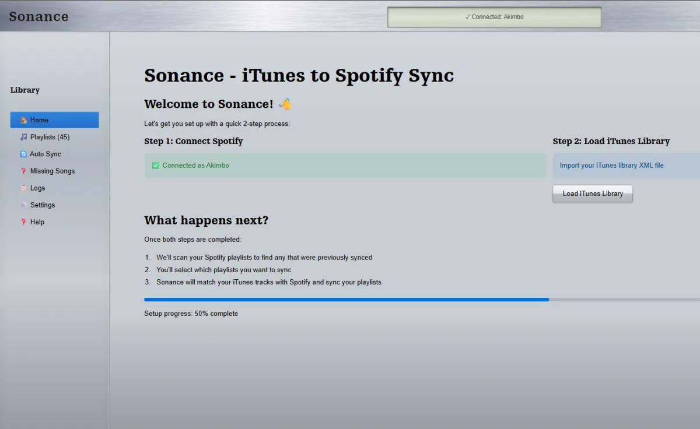
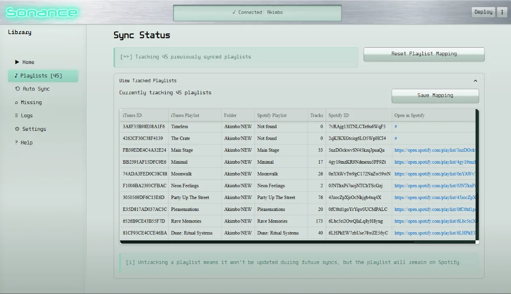

## Sonance

Sonance is a playlist synchronization tool built to bridge local music libraries and streaming platforms. The idea is straightforward: parse an iTunes XML library, understand its playlists and track structure, then recreate and maintain those playlists in Spotify without rebuilding everything by hand.

 

### Overview

This project is aimed at people who still curate music locally but want the convenience of streaming. iTunes libraries can contain years of playlist organization, track ordering, and editorial choices that do not transfer cleanly into modern platforms. Sonance treats that library as the source of truth and uses it to mirror playlists into Spotify.

### How it works

The system reads the iTunes XML export, extracts track metadata and playlist membership, then maps those tracks against Spotify’s catalogue through the Spotify API. Once matches are found, it can create or update Spotify playlists so they reflect the original library as closely as possible.

That means the main problems in the project are:
- parsing and normalizing iTunes library data
- matching local tracks to Spotify entries reliably
- preserving playlist structure and ordering
- making sync behavior predictable instead of destructive

### Current state

Sonance is still a work in progress, but the core concept is already strong: treat playlist sync as a data synchronization problem rather than a one-time import script. The long-term goal is to make it useful for real libraries across multiple machines, so changes to an iTunes-managed collection can be pushed back into Spotify in a way that feels consistent and low-friction.
